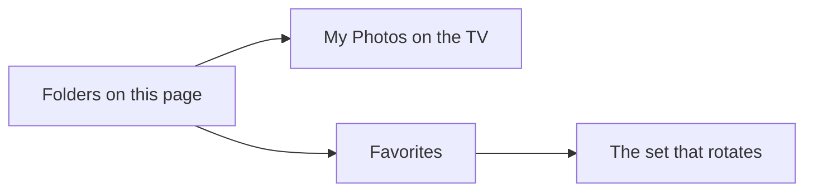

# Frame Art

Home Assistant app (formerly an add-on) for your own Samsung Frame pictures.

The TV keeps every uploaded photo in one pile. It can rotate all of them, or only Favorites. This page adds folders the TV does not have. Play a folder and that set becomes Favorites, which is the set the TV rotates. Remove deletes the picture from the TV.

## Install

This needs **Home Assistant OS** or **Supervised**. Container and Core installs do not have Apps.

That opens the add-repository dialog on your own Home Assistant, with this address filled in. To add it yourself:

1. **Settings → Apps → Install app**
2. Open the **⋮** menu at the top right and choose **Repositories**
3. Add `https://github.com/alexbbt/ha-frame-art`
4. Install **Frame Art** and start it
5. Set the TV address in the app options
6. Open **Open Web UI**, or port **8391** on the Home Assistant machine

The first time it connects, accept **Frame Art** on the TV. It runs on 64-bit Home Assistant (aarch64 or amd64).

To pick up a newer version, open the app and choose **Check for updates**.

## What the TV can store

| On the TV | What it is |
|-----------|------------|
| My Photos | Every picture this page uploads |
| Favorites | The one folder you chose to play |
| Slideshow | Either Favorites, or every photo |

There is no way to create more folders on the TV. Folders in this app are the way to keep sets and play one of them.

## Configuration

| Option | Default | Meaning |
|--------|---------|---------|
| `host` | empty | TV address on your network |
| `port` | `8001` | Art connection port. Use `8002` if the TV requires the encrypted port |
| `token` | empty | Leave empty for the on-screen prompt. Fill it in if the TV already gave this app a token |
| `slideshow_minutes` | `60` | How long each picture stays up |
