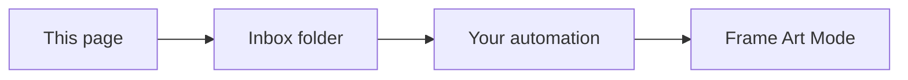

# Frame Art

Home Assistant app (formerly an add-on) with a web page for your own Samsung Frame pictures.

Drop JPEG, PNG, WebP, or iPhone photos on the page. They are saved into a folder on Home Assistant. An automation can send that folder to the TV's Art Mode, with no Samsung account and no Art Store.

## Install

This needs **Home Assistant OS** or **Supervised**. Container and Core installs do not have Apps.

That opens the add-repository dialog on your own Home Assistant, with this address filled in. To add it yourself:

1. **Settings → Apps → Install app**
2. Open the **⋮** menu at the top right and choose **Repositories**
3. Add `https://github.com/alexbbt/ha-frame-art`
4. Install **Frame Art** and start it
5. Open **Open Web UI**, or port **8391** on the Home Assistant machine

It runs on 64-bit Home Assistant (aarch64 or amd64).

To pick up a newer version, open the app and choose **Check for updates**.

## How a picture gets to the TV

This app does not talk to the TV itself. It only fills the inbox. The default folders are:

| Folder | Path |
|--------|------|
| New pictures | `/homeassistant/www/frame-art/inbox` |
| Already sent | `/homeassistant/www/frame-art/uploaded` |

Inside the Home Assistant container those are `/config/www/frame-art/inbox` and `/config/www/frame-art/uploaded`.

A picture leaves the waiting list when something else moves it from the inbox into the uploaded folder.

## Configuration

| Option | Default | Meaning |
|--------|---------|---------|
| `inbox` | `/homeassistant/www/frame-art/inbox` | Where uploads are written |
| `uploaded` | `/homeassistant/www/frame-art/uploaded` | Shown on the page as already sent |
